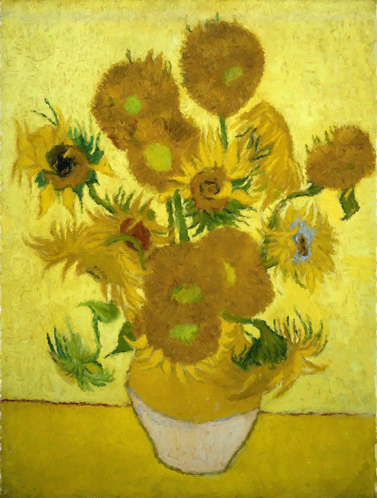

# USER GUIDE — 普通人完整使用说明（suite v1.0.2）

> 这份文档面向**第一次接触**的人：照着点就能做出「傅里叶笔画画」。
> 不需要懂代码，不需要 API Key（除非你要用 Krea2 API 模式），也不需要 GPU（没有会自动用 CPU）。
> 安装/排错另见 [`INSTALL.md`](INSTALL.md)；想了解原理见 [`ENGINEERING.md`](ENGINEERING.md)。

---

## 1. 这是什么？



*《向日葵》纯笔画复刻（v1.36 人类画师式笔画，约 10 万笔，2048 像素长边；无区域填色，每一笔都是真实曲线）。*

这套工具把图片变成**一笔一笔画出来的画**（不是滤镜、不是贴图）：每一笔都是真实画出来的曲线，
可以导出高清 PNG，也可以导出「傅里叶圆一笔一笔画出来」的过程视频。

它提供 **3 个功能**：

| # | 输入 | 中间 | 输出 |
|---|---|---|---|
| 1 | **一张图片**（插画/线稿/照片风格图） | 直接复刻成笔画画（**不用 AI**） | PNG 笔画画、`.fdraw` 笔画文件、作画视频 |
| 2 | **一句提示词** | 本地 Krea2 模型出图（**无需 API Key**）或 Krea2 API 出图 | 同上 |
| 3 | **已有的笔画画**（`.fdraw` 文件） | 重新渲染/出视频 | 任意分辨率 PNG、视频 |

**它不做什么**（先看，避免误会）：

- ❌ 不做**照片级保真**复刻；它是“用笔画画出来”的风格化复刻。
- ❌ **不能直接文字生图**：提示词必须先经 Krea2（本地/API）生成一张图，再画。
- ❌ 不支持手机端；只在 Windows + ComfyUI 上验证过。
- ❌ 没有 NVIDIA GPU / OpenGL 也能用，但渲染慢（CPU），且不是逐字节等同 GPU。

> ❤️ **赞助与支持**：本项目由个人独立开发维护，如果对你有帮助欢迎赞助支持。
> **赞助、合作或定制开发请联系：keminoco@outlook.com**

---

## 2. 准备清单

| 项目 | 要求 | 怎么确认 |
|---|---|---|
| 操作系统 | Windows 10/11 | — |
| ComfyUI | 已安装且能正常打开 | 双击启动器，浏览器能打开 ComfyUI 界面 |
| ComfyUI 自带 python | 安装器默认使用 | 见下方命令 |
| 磁盘空间 | 解压后约 **24–30 MB** + 你的输出 | 文件夹属性 |
| GPU（可选） | 想快就用；没有也能跑 | 有 NVIDIA 显卡 + 普通桌面即可 |
| Krea2 本地模型（仅功能 2 的本地模式） | UNET/CLIP/VAE 等已放入 ComfyUI models | 见 §5.2 |
| Krea2 API Key（仅功能 2 的 API 模式） | 在 ComfyUI Settings → API Keys 填 | 见 §5.3 |

确认 ComfyUI python（PowerShell，把路径换成你的）：

```powershell
"D:\ComfyUI_windows_portable\python_embeded\python.exe" -c "import sys; print(sys.version)"
# 能打印 Python 3.10/3.11/3.12/3.13 即可
```

---

## 3. 安装（第一次，约 3 分钟）

> 详细版与常见失败见 [`INSTALL.md`](INSTALL.md)。这里只列最短路径。

1. **解压**发布包到任意目录，例如 `D:\FDP\fourier-drawing-suite-v1.0.2`（可以含空格/中文）。
2. 打开 **PowerShell**，进入发布包根目录：
   ```powershell
   cd "D:\FDP\fourier-drawing-suite-v1.0.2"
   ```
3. 运行安装器（把 `--comfyui` 换成你的 ComfyUI 目录）：
   ```powershell
   "D:\ComfyUI_windows_portable\python_embeded\python.exe" release\install.py --comfyui "D:\ComfyUI_windows_portable\ComfyUI"
   ```
   看到 `[install] 完成。后续步骤：…` 即成功；它已自动写好配置（`fdp_config.json`），**以后换机器才需要重跑**。
4. 如提示缺依赖，按提示运行（通常 ComfyUI 自带的都有，可跳过）：
   ```powershell
   "D:\ComfyUI_windows_portable\python_embeded\python.exe" -m pip install -r release\requirements-core.txt
   ```
5. **完全重启 ComfyUI**（关掉再开，不是刷新页面）。
6. 可选自检：
   ```powershell
   "D:\ComfyUI_windows_portable\python_embeded\python.exe" release\check_env.py --comfyui "D:\ComfyUI_windows_portable\ComfyUI"
   ```

---

## 4. 打开工作流（三种模式选一个）

在 ComfyUI 里把 `comfyui\workflows\` 下的 JSON **拖进浏览器窗口**，或菜单打开。
（ComfyUI 的“打开文件”对话框一般也定位到你的 `workflows` 目录，找不到就直接拖。）

| 你想做什么 | 用这个工作流 | 需要 AI/Key？ | 速度 |
|---|---|---|---|
| **只用一张图**，直接画 | `FDP_v136_Local_NoAI_UI.json` | ❌ 不用 | 最快 |
| **用提示词**，本地 Krea2 出图再画 | `FDP_v136_T2I_Krea2_Local_UI.json` | 本地模型，**不需要 Key** | 中（看显卡） |
| **用提示词**，Krea2 API 出图再画 | `FDP_v136_T2I_Krea2_API_UI.json` | 需要 **API Key** | 看网络 |
| 打开已有 `.fdraw` 出图 | `FDP_T2I_Krea2_fdraw_UI.json`（旧版） | ❌ | 快 |
| 把 `.fdraw` 变成作画视频 | `FDP_fdraw_to_fourier_video_UI.json` | ❌ | 慢（视频） |

**三种主模式怎么选**：

- **只有图、想马上看效果** → 模式 1（NoAI）。质量/速度最好控制，推荐先玩这个。
- **想用文字描述生成**，且已把 Krea2 模型装进 ComfyUI → 模式 2（本地 Krea2）。
- **没有本地模型 / 想用云端** → 模式 3（API，需 Key）。
- 不确定选哪个：先做模式 1 跑通，再试模式 2/3。

工作流里只有几个节点需要动（其余保持默认）：

| 节点 | 需要你动的 |
|---|---|
| `FDPT2IWorkflowStart` | `source_mode` 选 **图生图**（模式 1/3 手动图）或 **文生图**（模式 2） |
| `LoadImage` | 模式 1：上传你的图；模式 2/3 可忽略 |
| `FDPT2IBuildFromImageV136` | 主要参数（见 §6）；默认即可先跑 |
| `FDPT2IRenderFdraw` | `resolution` 输出分辨率（默认 **4096**；GPU 快，CPU 很慢） |

点 ComfyUI 右上角 **Queue / 运行**。第一次跑会慢一点（加载模型/初始化）。

---

## 5. 三种模式的操作细节

### 5.1 模式 1：图片 → 笔画画（不用 AI）

1. 打开 `FDP_v136_Local_NoAI_UI.json`。
2. `FDPT2IWorkflowStart` 的 `source_mode` 选 **图生图**。
3. `LoadImage` 节点点 **choose file** 上传你的图（白底插画/线稿/油画照片都行）。
4. 其余默认，点 **Queue**。
5. 输出见 §7；先看 `*_R2048.png` / `*_R4096.png`。

### 5.2 模式 2：提示词 → 本地 Krea2 → 笔画画（无需 API Key）

1. 打开 `FDP_v136_T2I_Krea2_Local_UI.json`。
2. `source_mode` 选 **文生图**；在 `CLIPTextEncode` 里写提示词（英文效果通常更稳）。
3. 确认 Krea2 模型已放进 ComfyUI 的 models 目录（UNET/CLIP/VAE 按工作流里 `UNETLoader`/
   `CLIPLoader`/`VAELoader` 显示的名字找；缺模型时 ComfyUI 会红框提示文件名）。
4. 点 **Queue**；先出图（KSampler），再自动进入笔画绘制。
5. 首次加载模型可能 1–3 分钟；显存不足时先把 `KSampler` 的分辨率/步数降低。

> 注意：**Krea2 分支上不要挂任何输出节点**（PreviewImage/SaveImage 等），否则即使选“图生图”，
> Krea2 也会被执行（ComfyUI 会执行所有输出节点）。新工作流已按 lazy 设计避免这个问题。

### 5.3 模式 3：提示词 → Krea2 API → 笔画画（需要 Key）

1. 打开 `FDP_v136_T2I_Krea2_API_UI.json`。
2. 先在 ComfyUI **Settings → API Keys** 里填 Krea2 的 Key（工作流里的 API 节点会用它）。
3. 写提示词，点 **Queue**。
4. 网络慢/失败时：重试一次；仍失败就换模式 2 或模式 1。

### 5.4 模式 1.5：已有 `.fdraw` → 重新出图/出视频

- 出图：`FDP_T2I_Krea2_fdraw_UI.json`，把 `fdraw_path` 指向你的 `.fdraw`（或 `.fdraw` 所在 run 目录）。
- 视频：`FDP_fdraw_to_fourier_video_UI.json`，参数见 §6.4；**视频很慢**（分钟级到十几分钟）。

---

## 6. 参数逐个解释（含推荐值）

### 6.1 画法节点 `FDPT2IBuildFromImageV136`

| 参数 | 默认 | 作用 | 推荐值 / 说明 |
|---|---|---|---|
| `work_res` | **1280** | 绘制工作分辨率（长边像素，256–2048） | **交互试参数用 512–1024（快）；交付用 1280–1536（细但慢）** |
| `resolution` | **1536** | `.fbs` 傅里叶采样目标分辨率（长边，≤1536 交付上限） | 1536 交付；交互用 512–1024 更快 |
| `quality` | **标准（快）** | 傅里叶精度预设（只影响 ε/N_max/曲线数，不影响画法） | 本地交互用“标准（快）”；出交付图用“高/极高”（更慢更精细） |
| `texture_flat` | **12000** | 细纹理层笔数（打散平色块/颜色分层）；0=关 | 插画/油画 **8000–20000**；线稿可 0–4000；太多会更糊 |
| `thick_dabs` | **0** | 厚涂短笔层笔数；0=关 | 油画/厚涂 **8000–20000**；平涂/线稿保持 0 |
| `clip_to_fg` | **True** | True=只画主体（白底留白，适合照片/线稿）；False=整幅铺 | 白底插画/线稿 **True**；全幅画作 False |
| `paint_order` | **region** | 绘制顺序：region=按区域成组（人类画法）；scan/legacy=旧扫描式 | 保持 **region**（v1.36 人类画师式；scan/legacy 只用于复现旧产物） |

> 还有自动参数（剪影感知）：白底插画会自动启用 `--silhouette auto`（修复轮廓溢出），
> 无需你设置；人像/全幅照片自动不触发。

### 6.2 输出节点 `FDPT2IRenderFdraw`

| 参数 | 默认 | 说明 |
|---|---|---|
| `resolution` | **4096** | 输出 PNG 长边（256–8192）。默认 4096 即交付级（GPU 约 22–28s）；GPU 想更快用 2048（约 15–19s）；CPU 下建议 1024–1536（4096 CPU 极慢）；极限 8192 很吃内存/显存 |
| GPU | 自动 | 默认自动 GPU；失败/无 GL 自动回退 CPU（见 §8） |

### 6.3 视频节点 `FDPT2IFourierVideo`

| 参数 | 默认 | 说明 |
|---|---|---|
| `size` | **2160x2160** | 视频尺寸；可 `3840x2160` / `3840x3840` |
| `circles` | **16384** | 参与计算的傅里叶圆数量（256–65536）；越多越精细越慢 |
| `duration_s` | **30** | 视频时长（2–300 秒）；先试 **2 秒/512 尺寸** 看效果 |

### 6.4 “太慢了怎么办”（按收益排序）

1. **降低输出分辨率**：`FDPT2IRenderFdraw.resolution` 4096→2048→1536（GPU 下 2048 约 15–19 秒）。
2. **降低 work_res**：`work_res` 1280→1024 或 512（笔更少、更快，细节略降）。
3. **texture_flat/thick_dabs 减半**（或设 0）。
4. **quality 选“标准（快）”**。
5. 走 CPU 时才考虑关 GPU：其实你该**确保 GPU 可用**（`check_env.py` 看 GPU PASS）。
6. 视频最后做：先用 2 秒小尺寸验证，再出长视频。

---

## 7. 输出在哪（目录结构）

默认在 ComfyUI 的 `output\fdp_t2i_runs\<时间戳>_<模式>\`，例如：

```
ComfyUI/output/fdp_t2i_runs/20261025_091500_i2i_ab12cd/
├── source.png                  本次输入图（扩散图或上传图）
├── layered_base_R1280.png      笔画画（工作分辨率）
├── layered_base_strokes.json   全部笔触（可再渲染/分析）
├── layered_base_report.json    参数与指标（笔数/耗时/质量/剪影等）
├── *.fbs.json                  傅里叶表示（编译产物）
├── *.fdraw                     便携笔画容器（可重复渲染/出视频）
├── fdraw_R2048.png             高分辨率渲染（按工作流设置）
├── fdraw_R4096.png             交付级渲染（若设置了 4096）
├── fdraw_R1024_gpu_timing.json GPU 渲染计时（有 GPU 时）
└── *.mp4                       作画视频（若运行了视频节点）
```

- 想找“最好看”的成品：优先看 `fdraw_R4096.png`（或 `fdraw_R2048.png`）。
- 想复用/换分辨率：用同一目录下 `.fdraw` 跑渲染节点。
- 想看耗时/是否用了 GPU：看 `*_report.json` 与 `*_timing.json`。

---

## 8. GPU 开关与速度参考

| 情况 | 行为 |
|---|---|
| 默认（有 PyOpenGL/glfw + 桌面 GL） | **自动 GPU 渲染**（`RenderFdraw` 内部调用 GPU，workflow 不用改） |
| 无 GL / 远程桌面 / 服务器 | 自动回退 **CPU exact**（慢，但可用；日志会说明） |
| 你想强制 CPU（对比/排错） | 启动 ComfyUI 前设环境变量 **`FDP_GPU_RENDER=0`** |
| 只跑单个文件（命令行） | `python workspace\skills\fourier-multistroke-training\scripts\gpu_render.py --fdraw X.fdraw --out X.png --resolution 4096`；`--device cpu` 走 CPU |

**速度参考（RTX 4070 Ti SUPER，chibi 38,737 笔；不同机器/并发有波动）**：

| 输出 | GPU | CPU exact（参考） |
|---|---|---|
| 1024 | **约 14–17 秒** | 219 秒 |
| 2048 | **约 15–19 秒** | 581.6 秒 |
| 4096 | **约 22–28 秒** | 约 21 分钟 |
| 4096（100k 笔真实节点，v1.38.1 修复后） | **约 56 秒**（故障回退 CPU 时 3159 秒） | 不适用（走 CPU 会 52.6min） |

画质：GPU 与 CPU 非常接近（PSNR 40.2–44.1 dB、SSIM ≥0.9957），差异集中在笔触边缘的
抗锯齿；**要逐字节等同 CPU 的旧产物时用 CPU**（`FDP_GPU_RENDER=0`）。

### 8.1 GPU 没生效 / 被静默回退 CPU？

- **先看输出**：目录里有 `fdraw_R4096_gpu.png` + `fdraw_R4096_gpu_timing.json` = 走了 GPU；
  只有 `*_exact.png` = 回退了 CPU。
- **v1.0.2 修复的经典问题**：ComfyUI 宿主 env `PYOPENGL_PLATFORM=egl` 被子进程继承 → Windows 无 EGL →
  `gpu_render.py` exit 3 → 自动回退 CPU（100k 笔 4096 曾需 3159s）。本版会自动清除该变量并重试，
  **无需重启 ComfyUI**；修复后同图 **56.4s**（≈56×）。
- **仍回退时**：确认 `FDP_GPU_RENDER` 没有设为 0；`release\requirements-gpu.txt` 已装；有桌面 OpenGL；
  看 ComfyUI 日志 `[FDP-T2I] GPU render ...` 行；`alpha<1` 文档与含 `region_fill` 的文档按设计走 CPU。
- 手动验证：`python workspace\skills\fourier-multistroke-training\scripts\gpu_render.py --fbs <x>.fbs --out test.png --resolution 512`
  （输出 `"device": "gl"` 即 GPU 可用）。


---

## 9. 常见问题（FAQ，含 GPU 未生效排查）

1. **GPU 渲染很慢/被静默回退 CPU**（输出只有 `*_exact.png`）：v1.0.2 已修复宿主
   `PYOPENGL_PLATFORM=egl` 继承导致的回退，**升级后无需重启 ComfyUI**；仍回退时按 §8.1 排查，
   或接受 CPU（慢但结果可用）。
2. **ComfyUI 里找不到 `FDPT2I` 节点**：节点没复制对/没重启。确认
   `<ComfyUI>\custom_nodes\ComfyUI-FDP-T2I\nodes.py` 存在，然后完全重启 ComfyUI。
3. **报 `ModuleNotFoundError: numpy/scipy/PIL`**：装依赖用错 python。要用 **ComfyUI 自带的
   python**：`"<ComfyUI python>" -m pip install -r release\requirements-core.txt`。
4. **报找不到 skill 脚本 / `workspace not found`**：发布包被移动或只解压了一部分。
   重新解压完整包；或在节点目录手写 `fdp_config.json` 指向 `workspace`（见 INSTALL §9）。
5. **GPU 渲染瞬间变成 CPU / 日志 exit 3**：先升级 v1.0.2（修复 egl env）；仍有问题则是缺
   PyOpenGL/glfw 或桌面 OpenGL，装 `release\requirements-gpu.txt` 或接受 CPU（见 §8.1）。
6. **显卡显存不足/渲染报错**：输出分辨率降到 1024/2048；`FDP_GPU_RENDER=0` 用 CPU。
7. **中文/空格路径报错**：本发布包已按含空格/中文路径测试过；若仍报错，先换纯英文短路径复现，
   并把错误信息发给维护者。
8. **提示词模式一直没有图**：本地 Krea2 缺模型（ComfyUI 红框会显示缺哪个）；或 API Key 没填/
   网络不通。先跑模式 1（NoAI）确认基础链路正常。
9. **画出来很“糊”/平色块明显**：提高 `work_res`（1280→1536）、提高 `texture_flat`、
   换更高 `quality`；白底插画确认 `clip_to_fg=True`。
10. **画出来轮廓有毛刺/溢出**：v1.37 起已针对白底插画做剪影修复；若仍有，尝试提高 `work_res`、
   降低 `texture_flat`、或把 `clip_to_fg` 设为 True（自动剪影在 v1.36 画法下启用）。
11. **作画视频太慢/太大**：先用 `duration_s=2`、`size=512x512`、`circles` 调小验证；视频渲染是
    CPU 路径，4096 尺寸+60 秒会非常久。

---

## 10. 这工具不做什么（明确边界）

- ❌ **照片级保真**：不会把照片“原样还原”，而是用笔画风格化复刻；照片类输入可能被
  `E_PHOTO_DEFERRED` 拒绝（这是设计，不是 bug）。
- ❌ **直接文字生图**：没有内置 LLM/扩散去“凭空”出图；提示词必须经 Krea2（本地/API）。
- ❌ **手机/网页在线**：只在 Windows + ComfyUI 桌面环境验证。
- ❌ **任何环境开箱即用**：GPU 需要桌面 OpenGL；headless 服务器只能用 CPU。
- ❌ **画质无损**：v1.36 相对旧基线 content PSNR −0.486 dB（质量子项 CONDITIONAL，见 CHANGELOG）；
  剪影羽化另有 −0.46 dB 同参考口径代价。追求“旧版逐字节”请用 CPU + legacy 参数。

---

## 11. 卸载 / 升级

- 升级：解压新发布包 → 重跑 `release\install.py --comfyui "<ComfyUI>"` → 重启 ComfyUI
  （`fdp_config.json` 会更新为发布包新位置）。
- 卸载：`"<ComfyUI python>" release\uninstall.py --comfyui "<ComfyUI>" --yes`，然后删除发布包目录；
  **不会**删除你的 `output\fdp_t2i_runs\` 产物。
- 保留配置：`fdp_config.json` 在节点目录里，卸载会一起删除；不想删可先备份。

---

## 12. 去哪看更多

- 安装失败 → [`INSTALL.md`](INSTALL.md) §10
- 想了解原理/改代码/让 AI 接手 → [`ENGINEERING.md`](ENGINEERING.md)
- 版本差异与已知限制 → [`CHANGELOG.md`](CHANGELOG.md)
- 测试证据与复现 → `test_artifacts/`（含 `reproduce.md` 与各版本 VERDICT）
